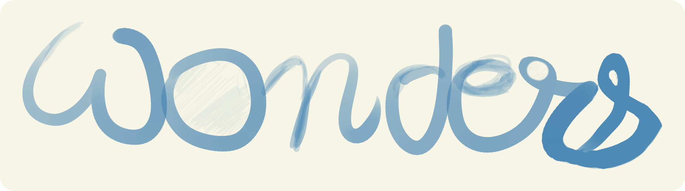
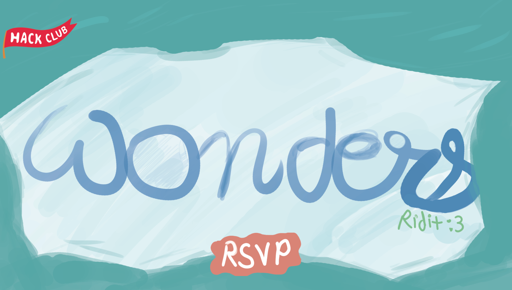
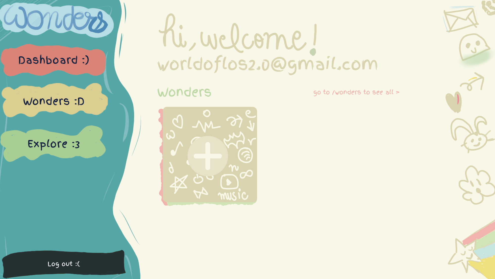
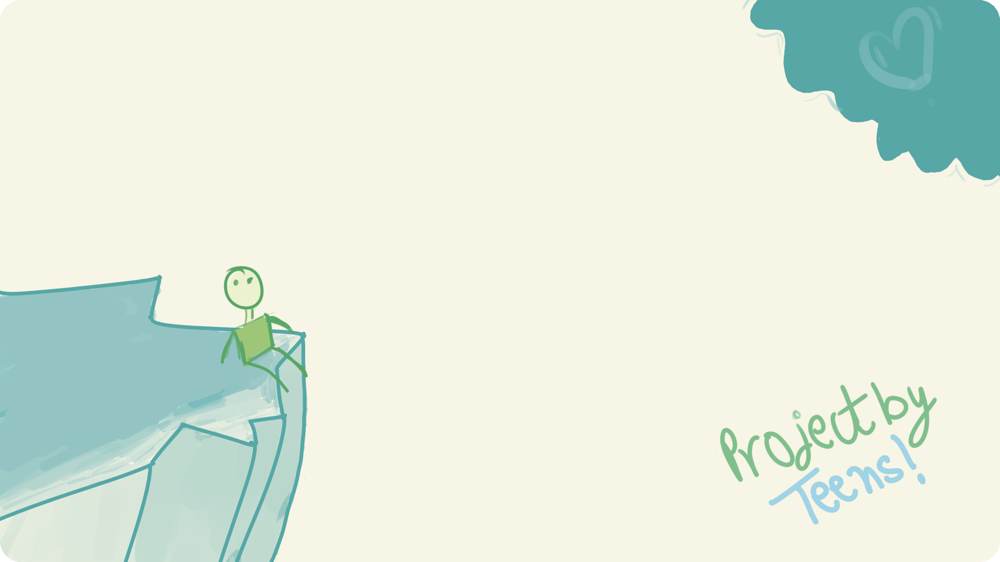

<p align="center">
  
</p>

<p align="center">
  A Hack Club YSWS where you build something only you could think of, ship it, and a real person reviews it. No hour counting.
</p>



## How it works

1. **Build a wonder.** Anything that feels like you. Hours don't matter.
2. **Ship it.** Add your repo and demo, then it waits for a reviewer.
3. **Get feedback.** A person plays with it and writes back. Then you wait for a surprise.



## Running it locally

You need [Bun](https://bun.sh).

```bash
bun install
bun run dev
```

The landing page works with no setup. The dashboard needs a `.env.local`, see `.env.example` for everything:

```bash
DATABASE_URL=
HC_AUTH_CLIENT_ID=
HC_AUTH_CLIENT_SECRET=
SESSION_SECRET=
```

The schema is in `db/schema.sql`:

```bash
psql "$DATABASE_URL" -f db/schema.sql
```

Next.js 16 here has breaking changes, so read `AGENTS.md` before touching framework code.



Noww go a wonder :3
